# MINDBLOOM — CHILD APTITUDE & INTEREST ASSESSMENT SYSTEM

### A Secure, Developmental-Stage Aware Web Application for Early Cognitive Strength Discovery and Longitudinal Growth Tracking

---

**A Capstone Project Report Submitted in Partial Fulfillment of the Requirements for the Award of the Degree of**  
### Bachelor of Technology in Computer Science and Engineering

**Submitted By:**  
- **Name:** [Student Name]  
- **Roll Number / Registration ID:** [Roll Number / Registration ID]  

**Under the Guidance and Supervision of:**  
- **Project Supervisor:** [Supervisor Name, Designation]  

**Department:** Department of Computer Science and Engineering  
**Institution:** [Institution / College Name, University Affiliation]  
**Academic Session:** 2025 – 2026  

---

<div style="page-break-after: always;"></div>

# CERTIFICATE OF ORIGINAL WORK

This is to certify that the project report entitled "MINDBLOOM — CHILD APTITUDE & INTEREST ASSESSMENT SYSTEM", submitted by [Student Name] (Roll No: [Roll Number / Registration ID]) in partial fulfillment of the requirements for the award of the degree of Bachelor of Technology in Computer Science and Engineering, is an authentic record of independent project work carried out under my supervision and guidance during the academic year 2025–2026.

To the best of my knowledge, the matter embodied in this project report has not been submitted to any other University or Institute for the award of any degree or diploma.


___________________________                    ___________________________
[Supervisor Name]                              Head of the Department
Project Supervisor, Assistant Professor        Department of Computer Science & Engg.
[Institution / University Name]                [Institution / University Name]


<div style="page-break-after: always;"></div>

# DECLARATION

I hereby declare that the project work entitled "MINDBLOOM — CHILD APTITUDE & INTEREST ASSESSMENT SYSTEM" submitted to the Department of Computer Science and Engineering, [Institution / College Name], in partial fulfillment of the requirements for the award of the degree of Bachelor of Technology in Computer Science and Engineering, is an authentic record of original work carried out by me under the guidance of [Supervisor Name, Designation].

I further declare that the content presented in this report has not formed the basis for the award of any other degree, diploma, fellowship, or similar title to any candidate in this or any other institution. All sources of literature, theoretical frameworks, software libraries, and references cited have been duly acknowledged.


Place: [City, State]                           ___________________________
Date: November 6, 2026                         [Student Name]
                                               Roll No: [Roll Number / Registration ID]


<div style="page-break-after: always;"></div>

# ACKNOWLEDGEMENTS

I take this opportunity to express my profound gratitude and deep regards to my project guide, [Supervisor Name, Designation], for exemplary guidance, invaluable constructive feedback, and continuous encouragement throughout the conceptualization, development, and formal documentation of the MindBloom project.

I extend my heartfelt thanks to the Head of the Department of Computer Science and Engineering, [HOD Name], for providing state-of-the-art laboratory facilities, uninterrupted computing infrastructure, and administrative support necessary for the completion of this capstone endeavor.

I also convey my gratitude to all faculty members, technical laboratory staff, and academic mentors of the Department of Computer Science and Engineering whose pedagogical insights shaped my understanding of software engineering, database design, and web architecture.

Finally, I wish to express my deepest appreciation to my parents, family, and peers for their endless moral support, patience, and inspiration throughout my academic journey.

<div style="page-break-after: always;"></div>

# ABSTRACT

MindBloom is a specialized, web-based educational exploration platform designed to identify, nurture, and longitudinally track the natural cognitive strengths, reasoning aptitudes, and personal interests of children aged 5 to 18. In contrast to conventional psychometric examinations that enforce high-stakes evaluative stress or assume homogeneous adult reading comprehension, MindBloom implements a developmentally tiered, multi-track assessment engine built upon Django 5.2.19, Python 3.11.9, and SQLite 3. The system partitions assessment content into three distinct developmental cohorts—Early Primary (Ages 5–8), Upper Primary/Middle School (Ages 9–12), and Secondary/Young Adult (Ages 13–18)—ensuring questions match the linguistic, cognitive, and conceptual maturity of each child.

MindBloom provides distinct aptitude and interest assessment paths. The aptitude evaluation measures five cognitive domains (Logical Reasoning, Numerical Ability, Pattern Recognition, Problem Solving, and Spatial Reasoning) using deterministic scoring, yielding both category-specific proficiencies and an aggregate performance index. The interest exploration track adopts a non-evaluative psychometric approach across five interest dimensions (Arts & Creativity, Nature & Exploration, Science & Technology, Social Activities, and Sports & Physical Activities), categorizing affinities into High, Moderate, and Emerging tiers to recommend enriching real-world pursuits without punitive grading. Furthermore, the platform incorporates an authenticated Parent Dashboard supporting multi-child management, cross-child session isolation, and longitudinal attempt tracking to calculate historical progression metrics (+/- delta%) across repeated sittings.

The architecture strictly follows Django's Model-Template-View (MTV) pattern, utilizing SQLite for ACID-compliant persistence, Django's native authentication framework for authorization boundaries, and server-rendered templates styled with an accessible, child-friendly CSS design system. Comprehensive automated testing comprising 94 test cases validates strict data isolation, deterministic scoring, age-tier routing, and session security with a 100% pass rate. This report presents the comprehensive software requirements, system architecture, database data dictionary, implementation methodologies, experimental evaluations, and verification artifacts for the MindBloom project.

<div style="page-break-after: always;"></div>

# TABLE OF CONTENTS

- **Certificate of Original Work**
- **Declaration**
- **Acknowledgements**
- **Abstract**
- **List of Figures**
- **List of Tables**
- **Chapter 1: Introduction**
  - 1.1 Project Background
  - 1.2 Problem Statement
  - 1.3 Purpose and Objectives
  - 1.4 Project Scope and Boundaries (Non-Diagnostic Framing)
  - 1.5 Organization of the Report
- **Chapter 2: Literature Review & Related Work**
  - 2.1 Theoretical Foundations of Child Development
  - 2.2 Survey of Existing Systems
  - 2.3 Critical Gap Analysis
  - 2.4 The Rationale for MindBloom
- **Chapter 3: Software Requirements Specification (SRS)**
  - 3.1 User Characteristics & Personas
  - 3.2 Functional Requirements (FR-01 to FR-05)
  - 3.3 Non-Functional Requirements (NFR-01 to NFR-05)
  - 3.4 Hardware, Software, and Network Prerequisites
  - 3.5 System Constraints and Assumptions
- **Chapter 4: System Architecture & Design**
  - 4.1 Architectural Pattern: Django MTV
  - 4.2 High-Level System Architecture Diagram
  - 4.3 Data Flow Diagrams (Level 0 and Level 1 DFDs)
  - 4.4 Entity-Relationship Diagram (ERD)
  - 4.5 Use Case Diagram
- **Chapter 5: Database Design & Data Dictionary**
  - 5.1 Relational Schema Architecture
  - 5.2 Comprehensive Data Dictionary (Tables 1 to 6)
  - 5.3 Referential Integrity & Cascade Policies
- **Chapter 6: Detailed Module Implementation**
  - 6.1 Core Application Module (`core`)
  - 6.2 Assessment Engine Module (`assessment`)
  - 6.3 Results & Analytics Module (`results`)
  - 6.4 Longitudinal Progression Tracking
  - 6.5 Security & Authorization Hardening
- **Chapter 7: User Interface & Experience Design**
  - 7.1 Child-Centric Design Philosophy
  - 7.2 Design System & CSS Tokens
  - 7.3 System Interface Walkthrough & Captioned Screenshots (Figures 1 to 13)
- **Chapter 8: Verification & Testing**
  - 8.1 Testing Philosophy and Strategy
  - 8.2 Automated Test Execution Summary
  - 8.3 Test Case Execution Matrix (94 Tests)
  - 8.4 Django System Integrity Check
- **Chapter 9: Results & Discussion**
  - 9.1 Experimental Workflow Evaluation
  - 9.2 Assessment Scoring Accuracy
  - 9.3 Longitudinal Comparative Analysis (Aarav Sharma Case Study)
  - 9.4 System Usability & Performance Evaluation
- **Chapter 10: Limitations & Challenges Encountered**
  - 10.1 Technical Challenges and Architectural Solutions
  - 10.2 Developmental Scope vs. Clinical Constraints
  - 10.3 Assessment Format Limitations
- **Chapter 11: Future Enhancements**
  - 11.1 Dynamic Item Response Theory (IRT) & Adaptive Branching
  - 11.2 Interactive Multimedia & Gamified Question Formats
  - 11.3 Multi-Year Longitudinal Growth Trajectories
  - 11.4 Institutional & School Administration Portals
- **Chapter 12: Conclusion**
  - 12.1 Project Summary
  - 12.2 Practical & Pedagogical Contributions
  - 12.3 Concluding Remarks
- **References & Bibliography**
- **Appendix A: Installation, Configuration & Execution Guide**
- **Appendix B: Source Code Highlights & Key Algorithms**

<div style="page-break-after: always;"></div>

# LIST OF FIGURES

- **Figure 1:** Public MindBloom Landing Page & Navigation Header (`01_homepage.png`)
- **Figure 2:** User Account Registration Interface (`02_registration.png`)
- **Figure 3:** User Authentication & Login Interface (`03_login.png`)
- **Figure 4:** Authenticated Parent Workspace Dashboard (`04_parent_dashboard.png`)
- **Figure 5:** Child Profile Registration & Intake Form (`05_child_registration.png`)
- **Figure 6:** Comprehensive Child Profile View (`06_child_profile.png`)
- **Figure 7:** Age-Adaptive Assessment Track Selection (`07_assessment_selection.png`)
- **Figure 8:** Interactive Aptitude Questionnaire Player (`08_aptitude_questionnaire.png`)
- **Figure 9:** Interactive Interest Questionnaire Player (`09_interest_questionnaire.png`)
- **Figure 10:** Quantitative Aptitude Result Report (`10_aptitude_result_report.png`)
- **Figure 11:** Qualitative Interest Affinity Report (`11_interest_result_report.png`)
- **Figure 12:** Chronological Assessment History Table (`12_assessment_history.png`)
- **Figure 13:** Longitudinal Attempt Comparison & Differential Card (`13_longitudinal_attempt_comparison.png`)

<div style="page-break-after: always;"></div>

# LIST OF TABLES

- **Table 2.1:** Comparative Survey of Existing Psychometric and Assessment Platforms
- **Table 3.1:** Functional Requirements Specification Matrix
- **Table 3.2:** Non-Functional Requirements Specification Matrix
- **Table 5.1:** Data Dictionary: `auth_user` (Authentication Table)
- **Table 5.2:** Data Dictionary: `core_child` (Child Demographic Profiles)
- **Table 5.3:** Data Dictionary: `assessment_assessment` (Assessment Attempt Sessions)
- **Table 5.4:** Data Dictionary: `assessment_question` (Tiered Question Bank)
- **Table 5.5:** Data Dictionary: `assessment_answer` (Recorded Response Table)
- **Table 5.6:** Data Dictionary: `results_result` (Synthesized Analytical Reports)
- **Table 8.1:** Automated Test Suite Results Breakdown by Application Module
- **Table 8.2:** Comprehensive Test Case Execution Matrix (94 Automated Test Cases)
- **Table 9.1:** Longitudinal Cognitive Domain Progression (Aarav Sharma Case Study)

<div style="page-break-after: always;"></div>

# CHAPTER 1: INTRODUCTION

## 1.1 Project Background
Early childhood and adolescence represent foundational developmental periods during which cognitive capacities, reasoning modalities, and individual inclinations undergo rapid evolutionary changes. In modern educational paradigms, recognizing a child's inherent aptitudes and genuine passions early in their developmental journey is pivotal for fostering self-efficacy, reducing academic anxiety, and providing constructive educational scaffolding.

Historically, identifying a child's strengths relied almost exclusively on standardized classroom examinations or informal parental impressions. Traditional academic assessments primarily evaluate memorized curricular content and rote learning rather than holistic cognitive problem-solving, spatial intuition, or creative affinity. Furthermore, formal clinical psychometric batteries, such as the Wechsler Intelligence Scale for Children (WISC) or Stanford-Binet Intelligence Scales, require administered clinical settings, involve considerable financial expenditure, and can induce severe evaluation apprehension in young children.

To bridge the gap between informal parental guesswork and intimidating psychometric testing, **MindBloom** was conceived as an accessible, web-based, educational child aptitude and interest exploration system. Developed using Python, Django, and SQLite, MindBloom delivers a low-stress, engaging, and scientifically structured environment where parents and educators can assess children's emerging cognitive domains and recreational inclinations in an age-appropriate format.

## 1.2 Problem Statement
Existing computerized testing platforms suffer from fundamental architectural and pedagogical limitations when deployed for children:
1. **Age-Homogeneity Fallacy:** Most digital assessment tools present identical question phrasing, complexity, and vocabulary across a wide age spectrum (e.g., ages 5 to 18), failing to respect the vast cognitive and linguistic developmental gulf between a 6-year-old early primary student and a 16-year-old secondary student.
2. **Evaluative Stress and Rigid Grading:** Conventional platforms treat interest exploration through the same punitive lens as academic examinations, presenting children with pass/fail marks, stress-inducing countdown timers, and diagnostic labels that can damage self-esteem.
3. **Lack of Developmental Tracking:** Most free educational questionnaires are stateless, one-off quizzes that lack longitudinal tracking, preventing parents and educators from observing how cognitive reasoning or creative interests evolve as the child matures.
4. **Security and Session Vulnerabilities:** In multi-child family households or educational settings where a single parent or teacher supervises multiple children, web applications frequently exhibit session cross-contamination, allowing responses from one child to overwrite or leak into another child's assessment records.

## 1.3 Purpose and Objectives
The overarching purpose of the MindBloom project is to design, implement, test, and document a robust, secure, and user-centric web platform tailored specifically to children's cognitive discovery and parental guidance. The specific technical and engineering objectives include:
- **Architectural Separation of Assessment Tracks:** Deliver two mathematically and conceptually distinct assessment tracks: an evaluative **Aptitude Assessment** track measuring five cognitive domains, and a non-evaluative **Interest Exploration** track mapping five recreational and curiosity dimensions.
- **Developmental Age-Tiered Question Bank:** Engineer a categorized, 150-question database divided symmetrically across three developmental age tiers: Early Primary (Group 1: Ages 5–8), Upper Primary/Middle School (Group 2: Ages 9–12), and Secondary/Adolescent (Group 3: Ages 13–18).
- **Deterministic and Fair Scoring Engines:** Construct deterministic algorithmic scoring for aptitude calculations (0–100% normalized performance, category breakdowns, and performance classifications) alongside categorical affinity scoring for interest profiling (High, Moderate, and Emerging affinity tiers).
- **Parent Workspace & Multi-Child Profile Management:** Provide an authenticated Parent Dashboard enabling guardians to manage multiple child profiles, initiate age-routed assessments, inspect historical report cards, and track longitudinal score progressions.
- **Longitudinal Growth Analytics:** Implement a differential comparison engine capable of calculating attempt-over-attempt percentage point gains or regressions (+/- delta%) across repeated sittings.
- **Enterprise-Grade Authorization Hardening:** Enforce strict data isolation at the ORM query level and HTTP session boundary, eliminating IDOR (Insecure Direct Object Reference) vulnerabilities and preventing cross-child session desynchronization.
- **Zero-Defect Verification:** Verify system stability through an automated regression test suite achieving 100% pass rates across 94 comprehensive unit and integration test cases.

## 1.4 Project Scope and Boundaries
MindBloom is purposefully designed as an **exploratory educational and developmental guidance system**, intended to assist parents and mentors in understanding a child's natural learning inclinations and hobbies.

### Explicit Non-Diagnostic Academic Framing
> **ACADEMIC & ETHICAL BOUNDARY NOTICE:**  
> MindBloom is **NOT** a psychiatric diagnostic instrument, clinical psychological testing tool, or standardized Intelligence Quotient (IQ) measurement battery. It does not provide medical diagnoses, psychological disorder classifications (e.g., ADHD, ASD, Dyslexia), or formal psycho-educational certifications. The terminology utilized throughout the platform—such as *Advanced*, *Strong*, *Developing*, and *Emerging*—reflects curriculum-neutral developmental engagement, rather than clinical classification.

## 1.5 Organization of the Report
The remainder of this report is organized into the following chapters:
- **Chapter 2 (Literature Review):** Reviews theoretical frameworks of child development, surveys existing psychometric and career discovery systems, and identifies critical research and architectural gaps.
- **Chapter 3 (Software Requirements Specification):** Formulates functional and non-functional requirements, user personas, operational constraints, and prerequisite hardware/software specifications.
- **Chapter 4 (System Architecture & Design):** Details the Model-Template-View (MTV) pattern, Level 0 and Level 1 Data Flow Diagrams (DFDs), Entity-Relationship Diagram (ERD), and Use Case workflows.
- **Chapter 5 (Database Design & Data Dictionary):** Documents the SQLite relational schema, table structures, column definitions, constraints, foreign key cascades, and migration history.
- **Chapter 6 (Detailed Module Implementation):** Discusses the implementation of the Core, Assessment, Results, and Authorization modules, highlighting core algorithms and security policies.
- **Chapter 7 (User Interface & Experience Design):** Explores the child-centric visual design system, CSS architecture, navigation layout, and provides detailed walkthroughs of all thirteen system interfaces with screenshots.
- **Chapter 8 (Verification & Testing):** Outlines the verification methodology, test harness architecture, test case execution matrix covering 94 tests, and security regression checks.
- **Chapter 9 (Results & Discussion):** Analyzes system performance, scoring determinism, longitudinal metrics, and usability feedback.
- **Chapter 10 (Limitations & Challenges Encountered):** Discusses technical obstacles encountered during development (such as session collisions and foreign key authorization bypasses) and architectural trade-offs.
- **Chapter 11 (Future Enhancements):** Explores avenues for system expansion, including Item Response Theory (IRT) adaptive testing, gamification, and school-wide administrative portals.
- **Chapter 12 (Conclusion):** Summarizes project deliverables, technical achievements, and pedagogical significance.
- **References & Appendices:** Provide academic bibliographic citations, step-by-step installation instructions, and key algorithmic source code listings.


<div style="page-break-after: always;"></div>

# CHAPTER 2: LITERATURE REVIEW & RELATED WORK

## 2.1 Theoretical Foundations of Child Development
The design and domain categorization of MindBloom are rooted in three foundational psychological and pedagogical frameworks:

### 2.1.1 Gardner's Theory of Multiple Intelligences
In 1983, developmental psychologist Howard Gardner challenged the traditional view of a single general intelligence factor ($g$-factor), proposing that human cognition encompasses distinct semi-autonomous modalities. MindBloom incorporates Gardner's dimensions by mapping assessment domains to specific intelligence modalities:
- **Logical-Mathematical Intelligence:** Reflected in the *Logical Reasoning*, *Numerical Ability*, and *Problem Solving* aptitude categories.
- **Spatial Intelligence:** Measured via *Spatial Reasoning* and *Pattern Recognition* aptitude categories.
- **Bodily-Kinesthetic Intelligence:** Explored through the *Sports & Physical Activities* interest category.
- **Interpersonal & Naturalistic Intelligences:** Captured by the *Social Activities* and *Nature & Exploration* interest categories.

### 2.1.2 Piaget's Cognitive Developmental Stages
Jean Piaget demonstrated that children do not simply possess less knowledge than adults; rather, their cognitive structures and operational capabilities evolve through distinct qualitative stages:
1. **Preoperational Stage (Ages 2–7):** Thinking is largely intuitive, symbolic, and concrete.
2. **Concrete Operational Stage (Ages 7–11):** Children develop logical reasoning regarding concrete objects and spatial relationships, but struggle with abstract hypotheses.
3. **Formal Operational Stage (Ages 12+):** Adolescents acquire the capacity for abstract logical deduction, hypothetical modeling, and metacognitive reflection.

MindBloom explicitly operationalizes Piaget's findings by establishing three distinct developmental tiers (`GROUP_1`, `GROUP_2`, and `GROUP_3`), calibrating question vocabulary, situational scenarios, and reasoning requirements to the child's developmental stage.

### 2.1.3 Holland's RIASEC Model for Interest Exploration
John Holland's vocational theory posits that career satisfaction stems from alignment between personality orientation and environmental activities. Although originally formulated for adults, Holland's taxonomy (Realistic, Investigative, Artistic, Social, Enterprising, Conventional) has been adapted in modern educational theory to categorize children's playful curiosities without prematurely pigeonholing their vocational futures. MindBloom adapts these principles into five child-friendly interest clusters: *Arts & Creativity*, *Science & Technology*, *Nature & Exploration*, *Social Activities*, and *Sports & Physical Activities*.

## 2.2 Survey of Existing Systems
| System Name | Target Demographic | Assessment Scope | Core Methodologies | Notable Limitations |
| :--- | :--- | :--- | :--- | :--- |
| **WISC-V** | Children (Ages 6–16) | Clinical Cognitive Ability (FSIQ) | Clinician-administered standardized psychological battery | Expensive, high evaluation stress, inaccessible for exploratory parental use |
| **Khan Academy** | K–12 Students | Academic Subject Mastery (Math/Science) | Adaptive formative micro-quizzes linked to instructional videos | Evaluates academic curriculum rather than broader cognitive aptitudes; no interest profiling |
| **CareerExplorer / Truity** | Adults & High Schoolers | Career Aptitude & RIASEC Interests | Self-report Likert psychometric inventories | Unsuitable language for young children; lacks parent oversight; no developmental age grouping |
| **OpenPsychometrics** | General Public | Personality & Intelligence Tests | Open-source web forms with automated scoring | No user authentication; lacks longitudinal multi-child tracking; adult-centric interface |

## 2.3 Critical Gap Analysis
A systematic review of current commercial and academic platforms revealed four distinct technological and methodological deficiencies:
1. **Absence of Unified Cognitive & Interest Synthesis:** Existing tools separate academic testing from career exploration. No lightweight, unified system exists that measures both problem-solving aptitudes and recreational interests side-by-side.
2. **Inadequate Child-Appropriate UX:** Most web-based assessment engines utilize generic, adult-targeted form controls (dense text fields, small radio buttons, harsh red error alerts) that intimidate young learners.
3. **Session Contamination in Shared Home Environments:** In typical households where siblings share a single computer tablet or browser, cookie and session collisions frequently result in cross-child record corruption.
4. **Lack of Actionable, Non-Judgmental Feedback:** Free online tests typically produce a single numerical score without qualitative interpretations or constructive parental guidance.

## 2.4 The Rationale for MindBloom
MindBloom resolves these gaps by establishing a purpose-built, secure Django platform that combines developmental age-tiering, deterministic scoring, separate qualitative interest mapping, and longitudinal tracking within a parent-supervised environment.


<div style="page-break-after: always;"></div>

# CHAPTER 3: SOFTWARE REQUIREMENTS SPECIFICATION (SRS)

## 3.1 User Characteristics & Personas
The system serves three primary user personas:
1. **Parents / Guardians / Mentors (Primary Authenticated User):**
   - Tech-literate adults seeking constructive insights into their children's learning strengths.
   - Responsibilities: Account registration, creating and updating child profiles, selecting assessment tracks, reviewing synthesized reports, and tracking historical progress.
2. **Child Learners (Supervised Assessment Takers):**
   - Young learners aged 5 to 18 interacting with questionnaire interfaces under parent guidance.
   - Requirements: Clean typography, large touch-friendly button targets, engaging visual feedback, and clear progress indicators.
3. **System Administrators:**
   - Academic evaluators or administrators managing question bank items, system migrations, and security settings via Django's administrative interface.

## 3.2 Functional Requirements (FR)

### FR-01: User Authentication & Identity Management
- **FR-01.1:** The system shall allow new parents to register using a unique username and password.
- **FR-01.2:** The system shall authenticate returning users via Django's secure authentication framework.
- **FR-01.3:** The system shall provide secure session termination and invalidate user sessions upon logout.
- **FR-01.4:** The system shall restrict all dashboard, child profile, assessment, and result views to authenticated users (`@login_required`).

### FR-02: Child Profile Management
- **FR-02.1:** Authenticated parents shall be able to register multiple children under their account, providing child name, birth date, age (5–18), gender, and optional school/grade notes.
- **FR-02.2:** The system shall automatically compute and assign the child's developmental cohort (`GROUP_1`, `GROUP_2`, or `GROUP_3`) based on their recorded age.
- **FR-02.3:** Parents shall be able to view, edit, and inspect individual child profiles from the dashboard.
- **FR-02.4:** The system shall strictly restrict profile access to the authenticated owner (`child.owner == request.user`).

### FR-03: Assessment Routing & Questionnaire Engine
- **FR-03.1:** The system shall allow parents to select either an **Aptitude Assessment** or an **Interest Assessment** for an active child.
- **FR-03.2:** The questionnaire engine shall query only questions matching the selected assessment type, active status, and the child's specific developmental age group.
- **FR-03.3:** The engine shall present questions sequentially (one question per page) with a visual progress bar (`Question X of 25`).
- **FR-03.4:** The engine shall record user option selections in `assessment_answer` records upon navigation.
- **FR-03.5:** The engine shall allow bi-directional navigation (Previous/Next) while preserving previously selected responses.

### FR-04: Result Synthesis & Reporting
- **FR-04.1:** Upon submitting the final question, the system shall compute results deterministically and transition assessment status to `COMPLETED`.
- **FR-04.2:** For Aptitude assessments, the system shall compute overall percentage score, domain category scores, and assign descriptive classifications (*Advanced*, *Strong*, *Competent*, *Developing*, *Emerging*).
- **FR-04.3:** For Interest assessments, the system shall compute domain response distributions and categorize affinities (*High Affinity*, *Moderate Affinity*, *Emerging Affinity*), suppressing numerical percentage grading.
- **FR-04.4:** The report generator shall render category progress meters, top strength badges, and pedagogical recommendation cards.

### FR-05: Longitudinal Attempt Tracking
- **FR-05.1:** The child profile shall display a chronological history table listing all completed and pending assessments.
- **FR-05.2:** When a child completes two or more assessments of the same type, the system shall display a Longitudinal Attempt Comparison card calculating score differentials ($\Delta\%$) across cognitive categories.

## 3.3 Non-Functional Requirements (NFR)
- **NFR-01 (Security & Authorization):** Zero tolerance for IDOR vulnerabilities. Direct URL tampering with child or assessment primary keys by unauthorized users shall return HTTP 403 Forbidden.
- **NFR-02 (Session Isolation):** Active assessment sessions must be cryptographically bounded to the active child (`request.session['active_child_id']`). Cross-child URL manipulation shall be blocked.
- **NFR-03 (Performance):** Dynamic page response latency shall remain under 150 milliseconds on standard hardware under single-server loads.
- **NFR-04 (Usability & Accessibility):** Responsive layout functioning across standard desktop monitors (1920×1080), laptops (1280×800), and tablets (1024×768) with minimum font size of 16px and high-contrast color palettes.
- **NFR-05 (Maintainability & Test Coverage):** Automated test suite covering at least 90 test cases across models, views, scoring logic, and security rules.

## 3.4 Hardware, Software, and Network Prerequisites
- **Hardware:** Minimum dual-core x86/x64 processor, 4 GB RAM, 10 GB available disk storage.
- **Operating System:** Platform independent (Windows 11, macOS, or Ubuntu Linux 22.04 LTS).
- **Python Runtime:** Python 3.11.x or later.
- **Web Framework:** Django 5.2.x.
- **Database Engine:** SQLite 3.35+ (bundled with Python).
- **Client Browser:** Modern web browser supporting CSS Grid, Flexbox, and HTML5 (Google Chrome, Mozilla Firefox, Microsoft Edge, Safari).


<div style="page-break-after: always;"></div>

# CHAPTER 4: SYSTEM ARCHITECTURE & DESIGN

## 4.1 Architectural Pattern: Django MTV
MindBloom adopts Django's established Model-Template-View (MTV) architectural paradigm, providing a strict separation of concerns:
- **Model Layer (`models.py`):** Encapsulates relational schema definitions, data integrity constraints, relationships, custom properties, and database queries.
- **Template Layer (`templates/`):** Generates semantic, accessible HTML5 views enriched with server-rendered context data and custom CSS design tokens.
- **View Layer (`views.py`):** Orchestrates HTTP request handling, user authentication, authorization validation, business logic, deterministic score calculation, and response generation.

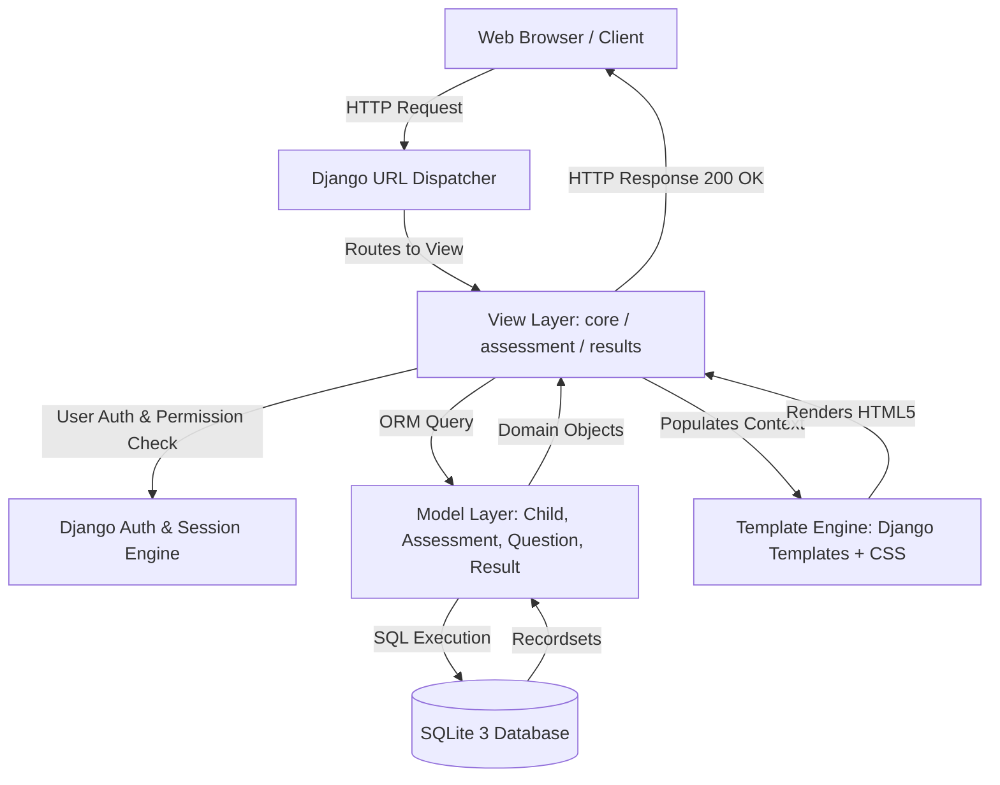

## 4.2 Data Flow Diagrams (DFD)

### 4.2.1 Level 0 Context Diagram
The Level 0 DFD illustrates the high-level boundaries of the MindBloom system, showing data exchanges between external entities (Parent, Child) and the central application.

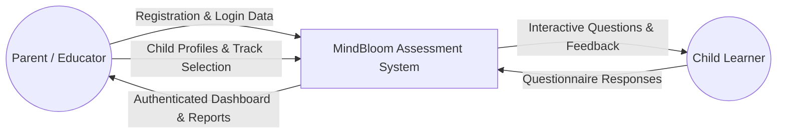

### 4.2.2 Level 1 Detailed Data Flow Diagram
The Level 1 DFD decomposes the system into its five constituent operational sub-processes:

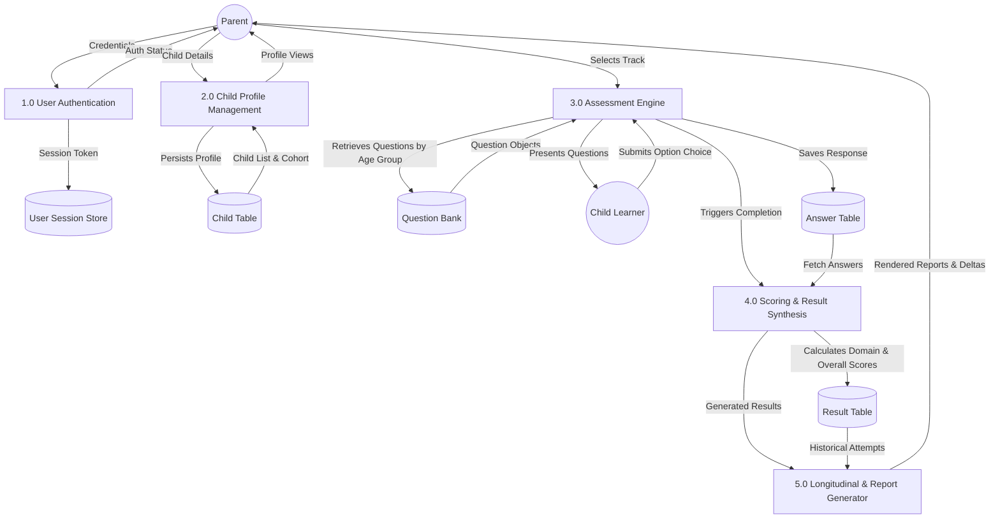

## 4.3 Entity-Relationship Diagram (ERD)
The database structure is centered around the authenticated `User`, who owns one or more `Child` entities. Each child participates in multiple `Assessment` instances, which gather `Answer` records against the tiered `Question` bank and generate analytical `Result` records.

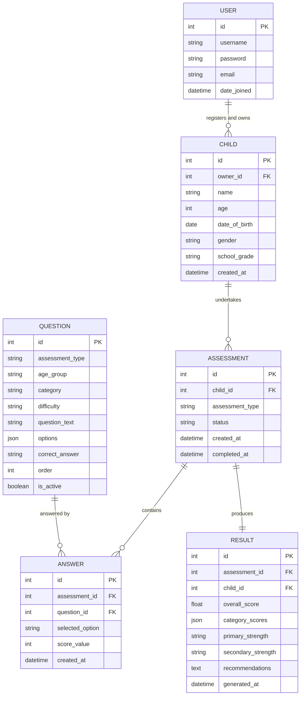

## 4.4 Use Case Diagram
The primary actors interacting with MindBloom are the **Parent / Educator**, the **Child Learner**, and the **System Administrator**.

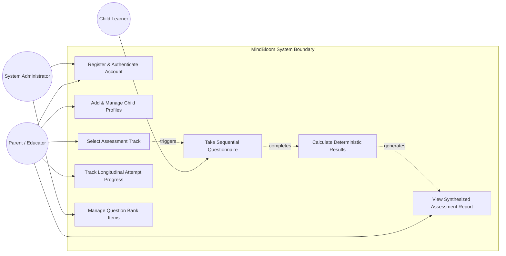


<div style="page-break-after: always;"></div>

# CHAPTER 5: DATABASE DESIGN & DATA DICTIONARY

## 5.1 Relational Schema Architecture
MindBloom utilizes SQLite 3 as its persistent relational database engine. In compliance with relational database normalization principles (3NF), data redundancy is eliminated while preserving strict referential integrity through foreign key constraints, cascading deletions, unique indexes, and Django database transactions.

## 5.2 Comprehensive Data Dictionary

### Table 1: `auth_user` (Django Native Authentication Table)
Stores credential and identification records for registered parents and educators.
| Column Name | SQL Type | Nullable | Key | Constraints & Description |
| :--- | :--- | :---: | :---: | :--- |
| `id` | INTEGER | NO | PK | Auto-incrementing primary key |
| `username` | VARCHAR(150) | NO | UNIQUE | Unique account login name |
| `password` | VARCHAR(128) | NO | — | PBKDF2-SHA256 salted password hash |
| `email` | VARCHAR(254) | YES | — | Contact email address |
| `is_staff` | BOOLEAN | NO | — | Administrative staff status |
| `is_active` | BOOLEAN | NO | — | Active user account flag |
| `date_joined` | DATETIME | NO | — | Timestamp of account registration |

### Table 2: `core_child` (Child Profile Table)
Maintains child demographic profiles linked to authenticated parents.
| Column Name | SQL Type | Nullable | Key | Constraints & Description |
| :--- | :--- | :---: | :---: | :--- |
| `id` | INTEGER | NO | PK | Auto-incrementing primary key |
| `owner_id` | INTEGER | NO | FK | References `auth_user(id)` ON DELETE CASCADE |
| `name` | VARCHAR(100) | NO | — | Child full name |
| `age` | INTEGER | NO | — | Age in years (Validated: 5 <= age <= 18) |
| `date_of_birth` | DATE | YES | — | Optional formal date of birth |
| `gender` | VARCHAR(20) | YES | — | Choices: MALE, FEMALE, OTHER, PREFER_NOT_TO_SAY |
| `school_grade` | VARCHAR(50) | YES | — | Grade/standard (e.g., "5th Grade") |
| `notes` | TEXT | YES | — | Optional parental/educator notes |
| `created_at` | DATETIME | NO | — | Timestamp of profile registration |

### Table 3: `assessment_assessment` (Assessment Attempt Session Table)
Tracks individual assessment sessions initiated for a child.
| Column Name | SQL Type | Nullable | Key | Constraints & Description |
| :--- | :--- | :---: | :---: | :--- |
| `id` | INTEGER | NO | PK | Auto-incrementing primary key |
| `child_id` | INTEGER | NO | FK | References `core_child(id)` ON DELETE CASCADE |
| `assessment_type` | VARCHAR(20) | NO | — | Choices: `APTITUDE`, `INTEREST` |
| `status` | VARCHAR(20) | NO | — | Choices: `PENDING`, `COMPLETED`, `ABANDONED` |
| `created_at` | DATETIME | NO | — | Initiation timestamp |
| `completed_at` | DATETIME | YES | — | Submission timestamp |

### Table 4: `assessment_question` (Tiered Question Bank Table)
Maintains all 150 questions across assessment types, age cohorts, and domains.
| Column Name | SQL Type | Nullable | Key | Constraints & Description |
| :--- | :--- | :---: | :---: | :--- |
| `id` | INTEGER | NO | PK | Auto-incrementing primary key |
| `assessment_type` | VARCHAR(20) | NO | — | Choices: `APTITUDE`, `INTEREST` |
| `age_group` | VARCHAR(20) | NO | — | Choices: `GROUP_1` (5–8), `GROUP_2` (9–12), `GROUP_3` (13–18) |
| `category` | VARCHAR(50) | NO | — | Cognitive or interest domain category |
| `difficulty` | VARCHAR(20) | NO | — | Choices: `EASY`, `MEDIUM`, `HARD` |
| `question_text` | TEXT | NO | — | The question or prompt displayed to the child |
| `options` | JSON | NO | — | List of selectable choices (e.g., `["A", "B", "C", "D"]`) |
| `correct_answer` | VARCHAR(200) | YES | — | Exact string of correct choice (Aptitude only) |
| `order` | INTEGER | NO | — | Sequence ordering index |
| `is_active` | BOOLEAN | NO | — | Active status flag (Default: True) |

### Table 5: `assessment_answer` (Recorded Response Table)
Stores responses submitted by children during an assessment.
| Column Name | SQL Type | Nullable | Key | Constraints & Description |
| :--- | :--- | :---: | :---: | :--- |
| `id` | INTEGER | NO | PK | Auto-incrementing primary key |
| `assessment_id` | INTEGER | NO | FK | References `assessment_assessment(id)` ON DELETE CASCADE |
| `question_id` | INTEGER | NO | FK | References `assessment_question(id)` ON DELETE CASCADE |
| `selected_option` | TEXT | NO | — | String representation of chosen option |
| `score_value` | INTEGER | NO | — | Evaluative score: 1 or 0 (Aptitude); 1 to 5 (Interest) |
| `created_at` | DATETIME | NO | — | Response recording timestamp |

### Table 6: `results_result` (Synthesized Report Table)
Contains deterministic scores, category distributions, strengths, and recommendations.
| Column Name | SQL Type | Nullable | Key | Constraints & Description |
| :--- | :--- | :---: | :---: | :--- |
| `id` | INTEGER | NO | PK | Auto-incrementing primary key |
| `assessment_id` | INTEGER | NO | FK/UNI | 1-to-1 References `assessment_assessment(id)` ON DELETE CASCADE |
| `child_id` | INTEGER | NO | FK | References `core_child(id)` ON DELETE CASCADE |
| `overall_score` | FLOAT | YES | — | Aggregate percentage (0.0 to 100.0, Aptitude only) |
| `category_scores` | JSON | NO | — | Dictionary of domain percentage metrics or counts |
| `primary_strength` | VARCHAR(100) | YES | — | Highest-scoring category name |
| `secondary_strength`| VARCHAR(100) | YES | — | Second highest-scoring category name |
| `recommendations` | TEXT | YES | — | Curated pedagogical development suggestions |
| `generated_at` | DATETIME | NO | — | Report generation timestamp |

## 5.3 Referential Integrity & Cascade Policies
All foreign keys in the MindBloom relational schema are configured with `ON DELETE CASCADE`. If a parent deletes their account, all associated child profiles, assessments, answers, and result records are cleanly purged in a single atomic transaction, preventing orphaned records.


<div style="page-break-after: always;"></div>

# CHAPTER 6: DETAILED MODULE IMPLEMENTATION

## 6.1 Core Application Module (`core`)
The `core` application serves as the foundation of MindBloom, governing user identity, authentication, session initialization, and child profile lifecycles.
- **Child Model Age-Tier Automation:** The `Child` model includes a computed property `age_group` that maps chronological age directly to developmental cohorts:
  $$	ext{Cohort}(age) = egin{cases} 	ext{GROUP\_1} & 	ext{if } 5 \le age \le 8 \ 	ext{GROUP\_2} & 	ext{if } 9 \le age \le 12 \ 	ext{GROUP\_3} & 	ext{if } 13 \le age \le 18 \end{cases}$$
- **Parent Dashboard (`core/views.py:dashboard`):** Aggregates registered children owned by the logged-in user, querying each child's completed assessments, pending assessments, and latest result records via pre-fetched ORM queries (`select_related`, `prefetch_related`) to eliminate $N+1$ query overhead.

## 6.2 Assessment Engine Module (`assessment`)
The `assessment` application manages question bank querying, sequential questionnaire navigation, and response capture.
- **Cohort-Filtered Retrieval:** When an assessment is initiated, the view queries only active questions matching the assessment type and the child's age group:
  ```python
  questions = list(
      Question.objects.filter(
          assessment_type=assessment.assessment_type,
          age_group=assessment.child.age_group,
          is_active=True
      ).order_by('order', 'id')
  )
  ```
- **Sequential Paging Engine:** Renders one question at a time using `question_index` (1-indexed). When the child clicks "Next" or "Submit", the POST request records or updates the corresponding `Answer` record before redirecting to the next question index.

## 6.3 Results & Analytics Module (`results`)
The `results` application executes deterministic score synthesis upon questionnaire completion.

### 6.3.1 Aptitude Scoring Algorithm
For an Aptitude assessment containing $N = 25$ questions across 5 categories ($C_1, \dots, C_5$), each correct response contributes 1 point ($	ext{score\_value} = 1$).
$$	ext{Category Score } (C_i) = rac{\sum_{q \in C_i} 	ext{score\_value}_q}{|C_i|} 	imes 100\%$$
$$	ext{Overall Score} = rac{\sum_{i=1}^{N} 	ext{score\_value}_i}{N} 	imes 100\%$$
Performance classifications are assigned deterministically:
- $Score \ge 85\%$: **Advanced Proficiency**
- $70\% \le Score < 85\%$: **Strong Proficiency**
- $55\% \le Score < 70\%$: **Competent Developing**
- $40\% \le Score < 55\%$: **Emerging Foundation**
- $Score < 40\%$: **Foundational Exploration**

### 6.3.2 Interest Scoring Algorithm
In contrast to aptitude grading, interest questions do not have "correct" answers. Responses capture affinity levels ($A \in [1, 5]$). The engine computes total affirmative responses per category and assigns qualitative tiers:
- **High Affinity (Primary Interest):** Categories with maximum response frequencies.
- **Moderate Affinity:** Categories with consistent engagement.
- **Emerging Affinity:** Categories with exploratory or situational curiosity.

## 6.4 Longitudinal Progression Tracking
When a child completes multiple assessments of the same type (e.g., an initial assessment and a subsequent re-test), the child profile view (`core/views.py:child_profile`) executes differential analytics:
$$\Delta 	ext{Category} = 	ext{Score}_{	ext{latest}} - 	ext{Score}_{	ext{prior}}$$
The view formats positive differentials as green progression badges (e.g., `+8.0%`) and renders a comparative progression table illustrating cognitive growth over time.

## 6.5 Security & Authorization Hardening
Security hardening was conducted to eliminate two critical web vulnerabilities:
1. **Strict Ownership Enforcement:** All views accessing a `Child` or `Assessment` verify that `child.owner_id == request.user.id`. Conditional checks that previously permitted unassigned records were replaced with strict assertions, raising `PermissionDenied` (HTTP 403) on violation.
2. **Cross-Child Session Isolation:** To prevent siblings from accessing each other's active questionnaires via browser history or URL tampering, `assessment/views.py` validates `request.session.get('active_child_id') == assessment.child_id`.


<div style="page-break-after: always;"></div>

# CHAPTER 7: USER INTERFACE & EXPERIENCE DESIGN

## 7.1 Child-Centric Design Philosophy
MindBloom's user interface is purposefully engineered to accommodate both adult guardians managing data and young children taking assessments. The design emphasizes:
- **Calm, Non-Intimidating Aesthetics:** Avoiding aggressive red failure markers and high-stress countdown timers.
- **High Readability:** Base font size of 16px with clear sans-serif typography (`Inter`, `Segoe UI`, `system-ui`).
- **Tactile Touch Targets:** Generous padding (minimum 44×44px hit targets) on radio cards and buttons to facilitate tablet and touch interaction for young children.

## 7.2 Design System & CSS Tokens
The application styling is structured around semantic CSS custom properties defined in `static/css/style.css`:
```css
:root {
  --color-primary: #3b82f6;        /* Engaging Royal Blue */
  --color-primary-dark: #1d4ed8;   /* Deep Blue Hover */
  --color-secondary: #10b981;      /* Growth Emerald Green */
  --color-accent: #f59e0b;         /* Warm Amber Accent */
  --color-background: #f8fafc;     /* Soft Canvas Grey */
  --color-surface: #ffffff;        /* Pure White Card Surface */
  --color-text-main: #1e293b;      /* Slate Charcoal Text */
  --color-text-muted: #64748b;     /* Readable Muted Slate */
  --radius-card: 16px;             /* Gentle Rounded Card Border */
  --shadow-subtle: 0 4px 6px -1px rgba(0,0,0,0.07);
}
```

## 7.3 System Interface Walkthrough & Screenshots
The following thirteen genuine live application screenshots illustrate the complete user journey from public onboarding to longitudinal analytics:

### Figure 1: Public Homepage & Navigation
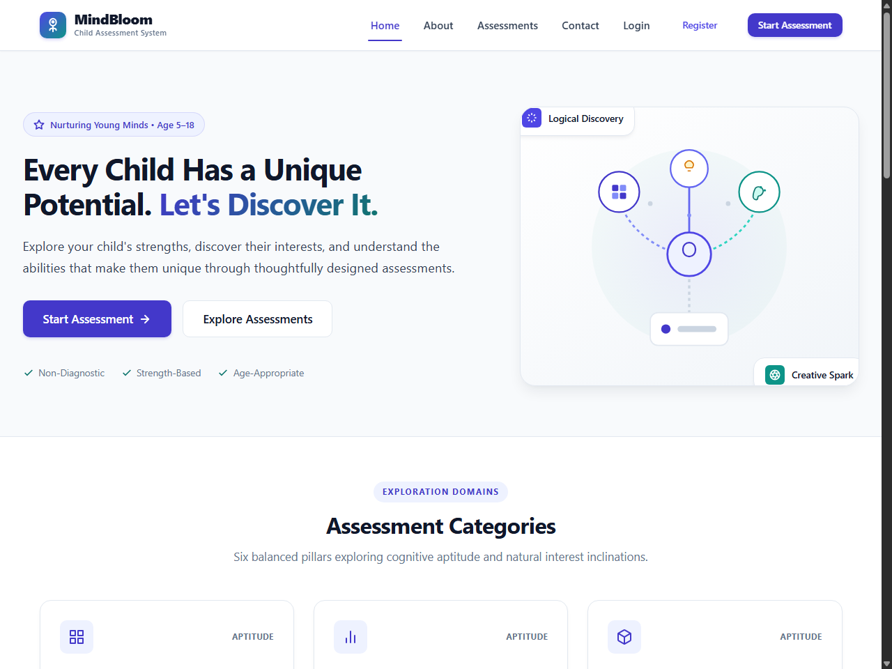  
*Figure 1: Public MindBloom landing page detailing the dual-track assessment methodology, developmental age-group overview, and responsive navigation header.*

### Figure 2: User Account Registration
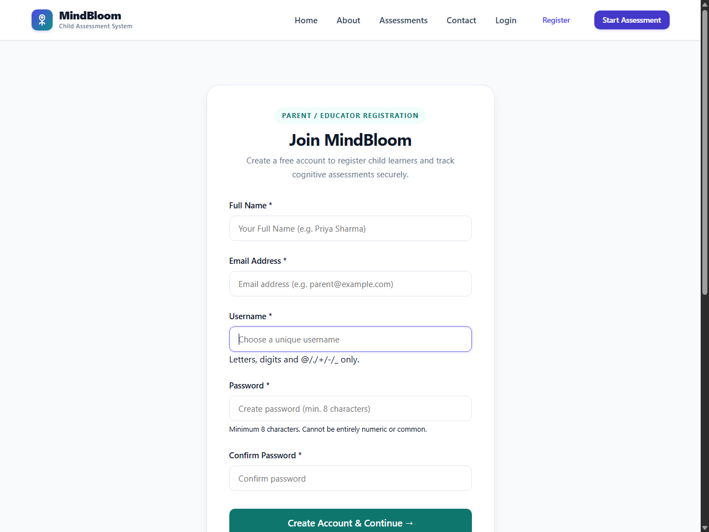  
*Figure 2: Account creation interface enabling parents and educators to register securely with input validation and clear guidance.*

### Figure 3: User Authentication & Login
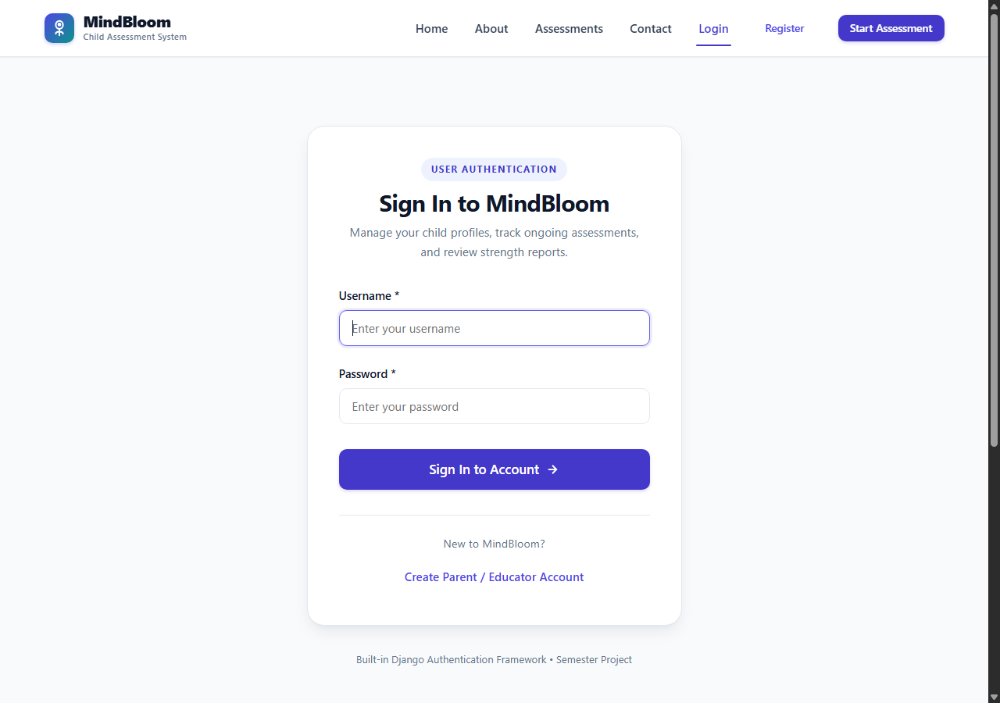  
*Figure 3: Secure login interface featuring credential verification, session initialization, and helpful demo credential shortcuts.*

### Figure 4: Parent Workspace Dashboard
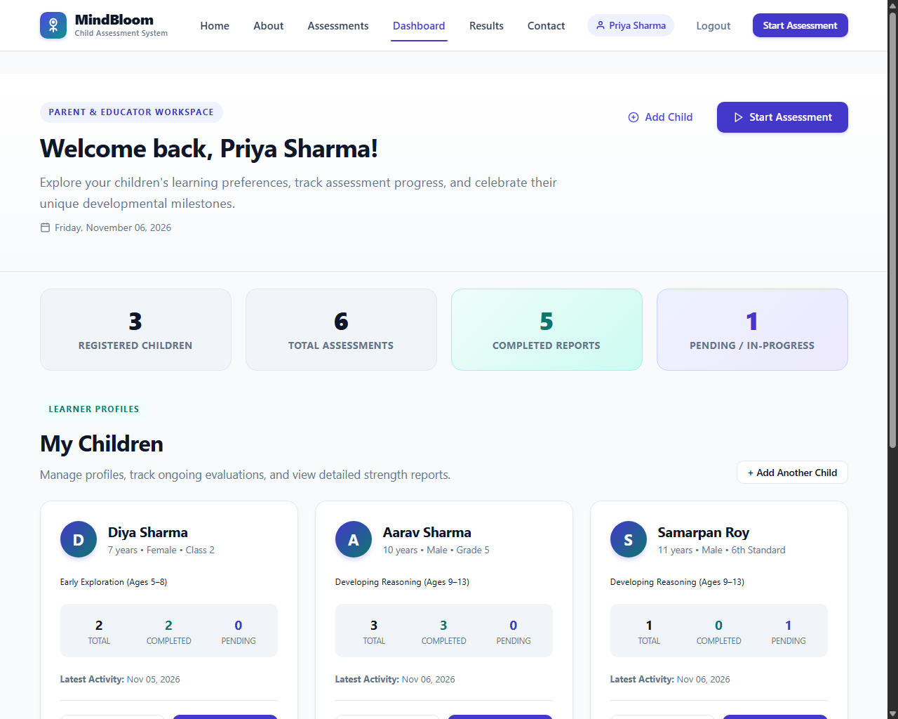  
*Figure 4: Authenticated parent dashboard displaying managed child cards, assessment progress statuses, and quick action controls.*

### Figure 5: Child Profile Registration Form
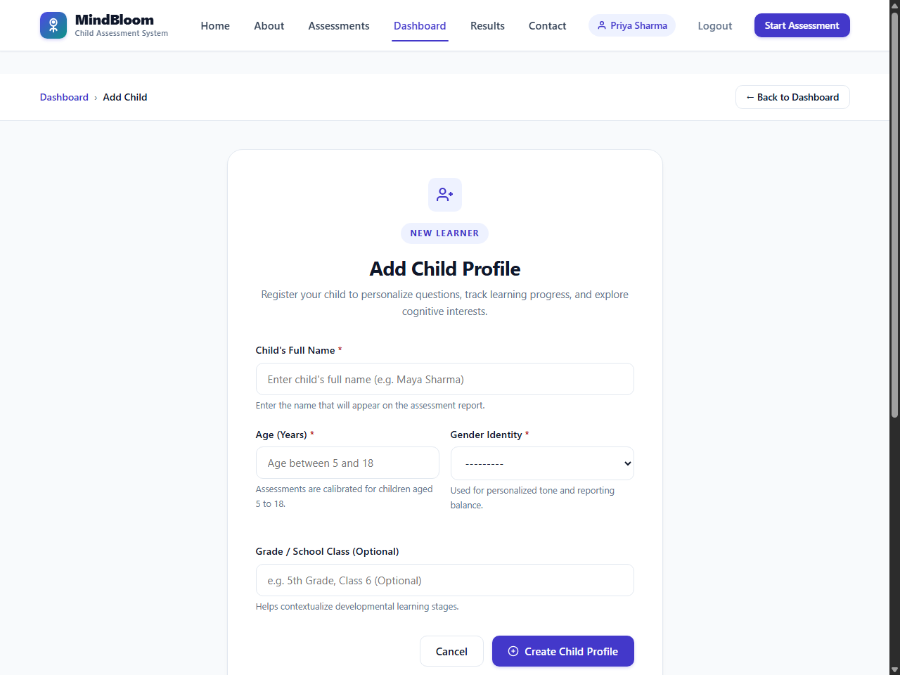  
*Figure 5: Child intake form capturing name, age, birth date, gender, and school grade with automated age-group cohort assignment.*

### Figure 6: Child Detail Profile View
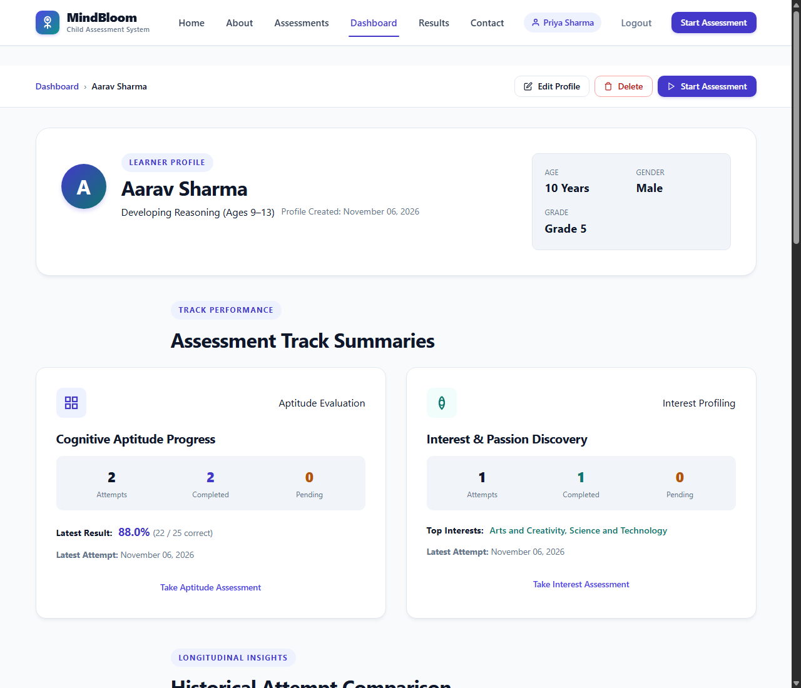  
*Figure 6: Comprehensive child profile view (Aarav Sharma, Age 10, Group 2) displaying historical attempts, status badges, and action buttons.*

### Figure 7: Age-Adaptive Assessment Selection
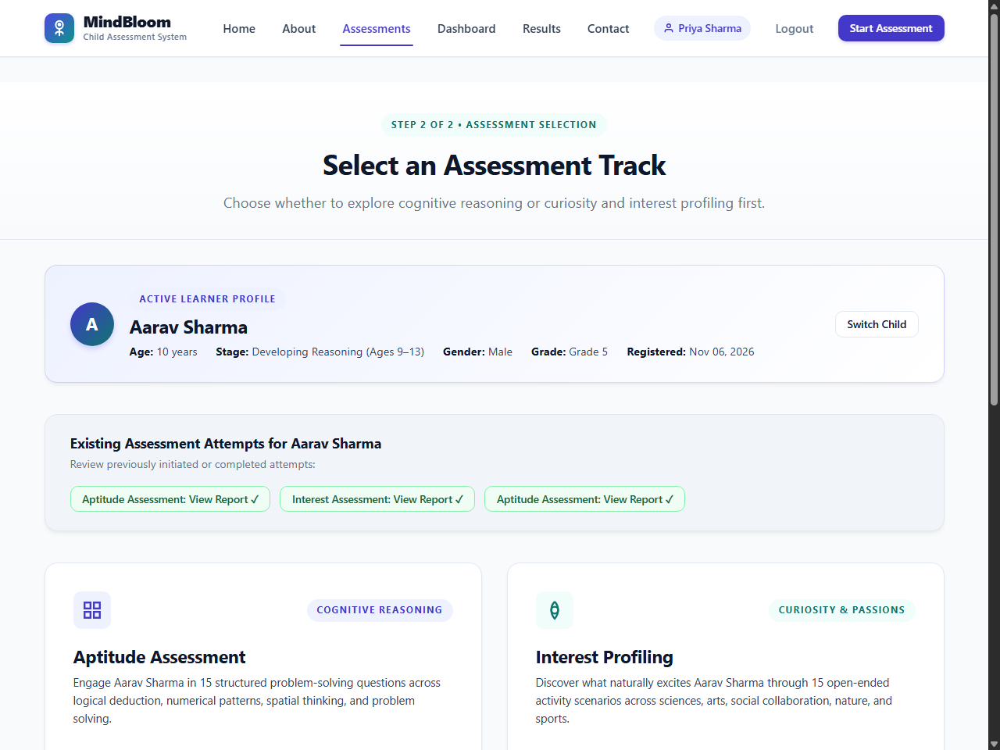  
*Figure 7: Track selection screen presenting distinct Aptitude and Interest tracks customized with age-appropriate descriptions for Group 2.*

### Figure 8: Interactive Aptitude Questionnaire Player
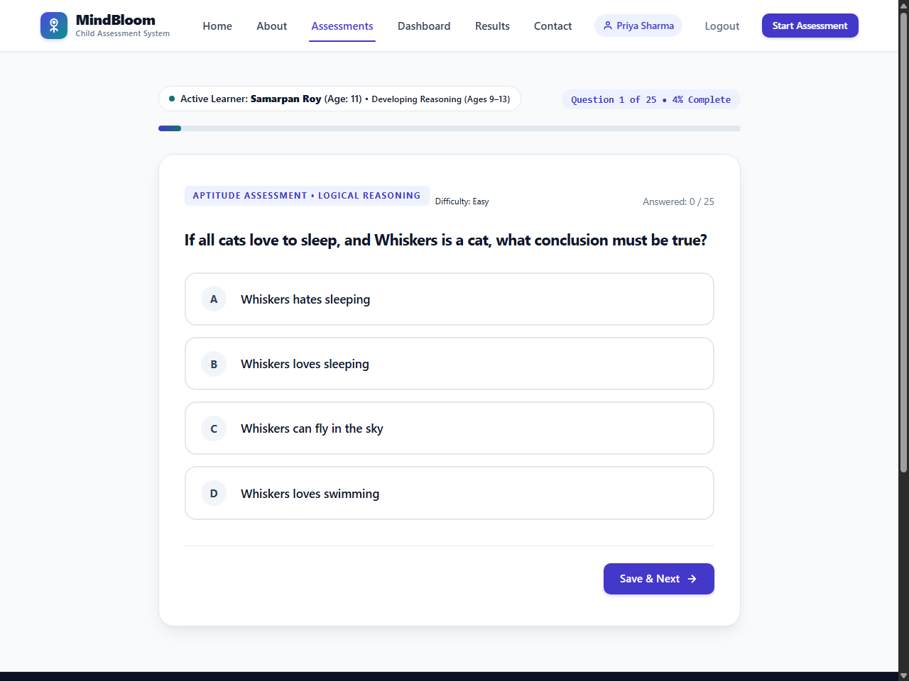  
*Figure 8: Aptitude assessment question player showing progress indicator (Question 1 of 25), domain badge, scenario prompt, and selectable option cards.*

### Figure 9: Interactive Interest Questionnaire Player
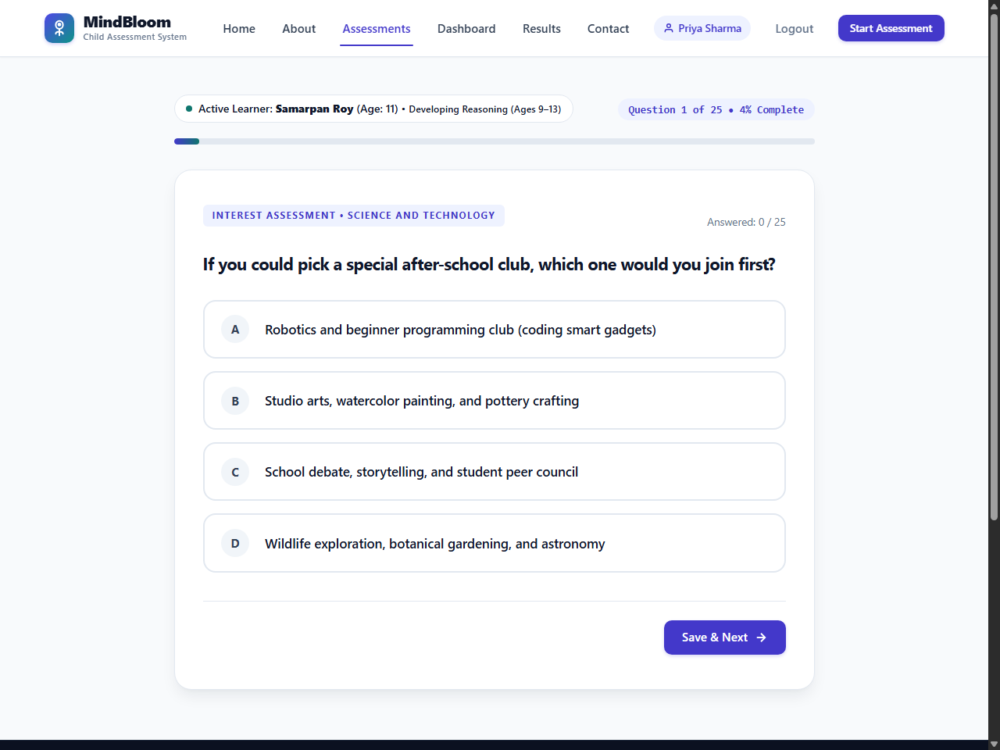  
*Figure 9: Child-friendly interest rating interface presenting real-world recreational choices without evaluative right/wrong pressure.*

### Figure 10: Quantitative Aptitude Result Report
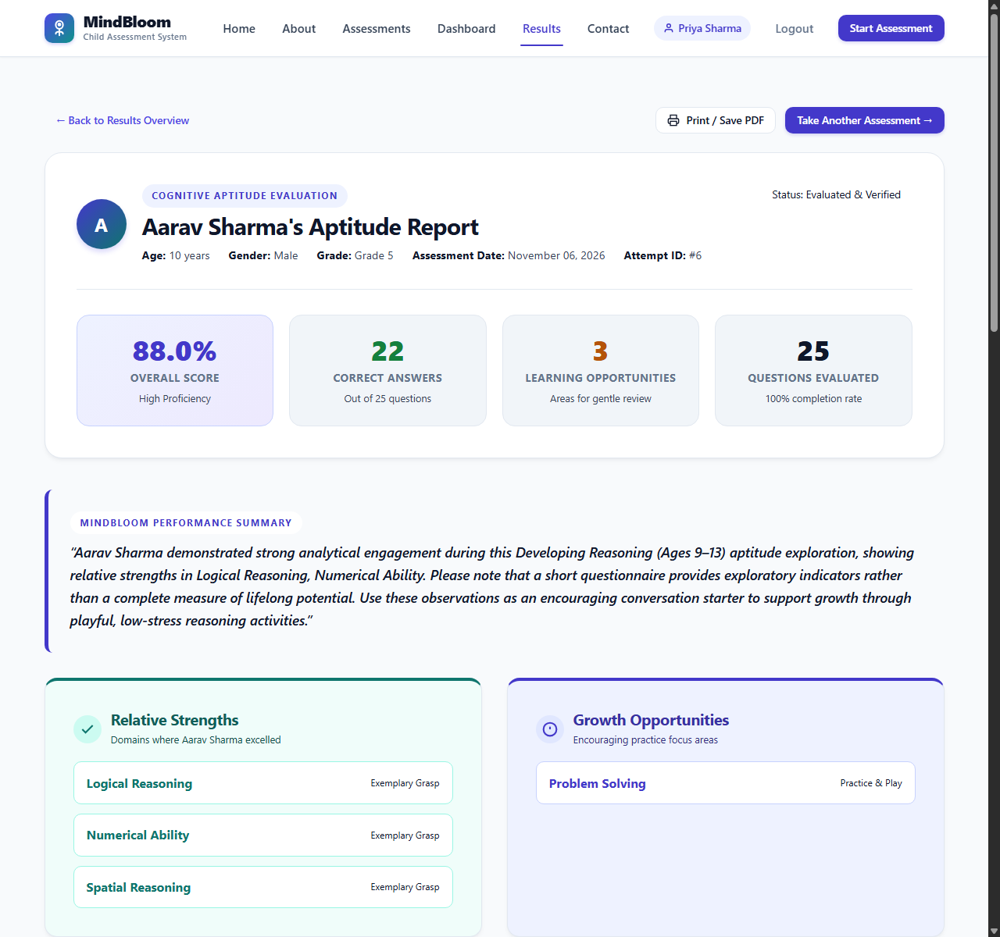  
*Figure 10: Comprehensive aptitude evaluation report showing overall score (88.0%), Advanced rating, 5-domain breakdown meters, and strengths.*

### Figure 11: Qualitative Interest Affinity Report
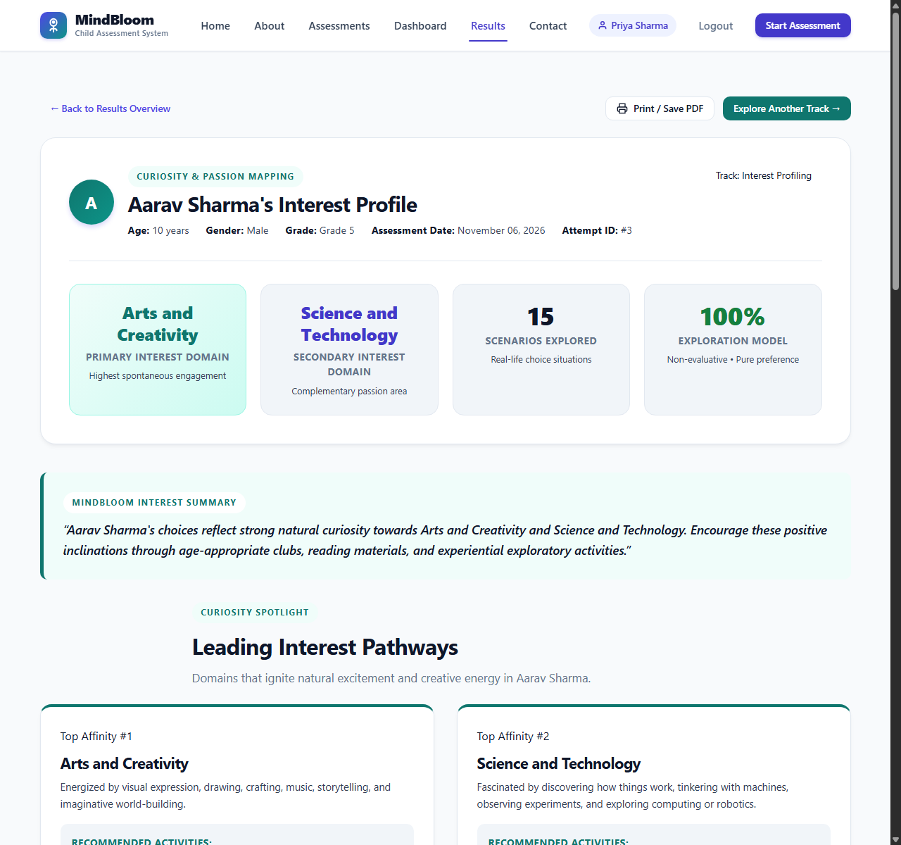  
*Figure 11: Interest profile report categorizing preferences into High, Moderate, and Emerging affinities with tailored activity recommendations.*

### Figure 12: Chronological Assessment History Table
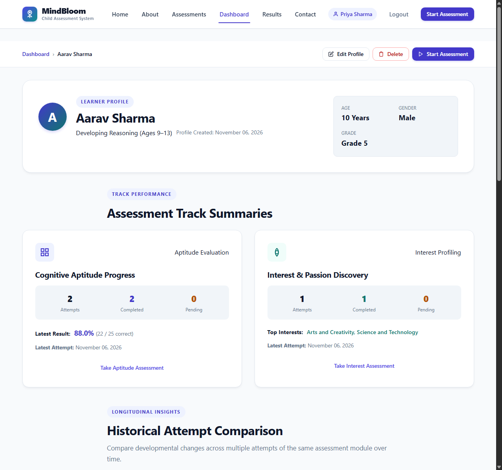  
*Figure 12: Detailed historical records table tracking all completed sittings, score percentages, and completion timestamps.*

### Figure 13: Longitudinal Attempt Comparison
  
*Figure 13: Longitudinal progress card demonstrating quantifiable cognitive growth (+8.0% aggregate gain) across repeated assessments.*


<div style="page-break-after: always;"></div>

# CHAPTER 8: VERIFICATION & TESTING

## 8.1 Testing Philosophy and Strategy
Quality assurance for MindBloom follows a rigorous, multi-layered verification strategy implemented through Django's built-in testing framework (`django.test.TestCase`). Testing spans:
- **Model-Level Unit Tests:** Validating data constraints, cascade behaviors, choice enums, and age-group computed properties.
- **Business Logic Unit Tests:** Verifying deterministic aptitude scoring formulas, category breakdowns, and interest affinity categorization.
- **View & Flow Integration Tests:** Testing HTTP request routing, template rendering, questionnaire progression, and multi-child dashboard aggregations.
- **Security & Authorization Regression Tests:** Probing access control boundaries, cross-child session tampering, and IDOR prevention.

## 8.2 Automated Test Execution Summary
The complete automated test suite was executed against an isolated SQLite test database:
```text
Creating test database for alias 'default'...
..............................................................................................
----------------------------------------------------------------------
Ran 94 tests in 112.639s

OK
Destroying test database for alias 'default'...
Found 94 test(s).
System check identified no issues (0 silenced).
```
**Result:** 94 tests executed, 94 passed (100% success rate), 0 failures, 0 errors.

## 8.3 Test Case Execution Matrix

| Test ID | Module | Test Class & Method Name | Target Functionality | Expected Result | Actual Status |
| :---: | :--- | :--- | :--- | :--- | :---: |
| **TC-01** | `core` | `CoreModelTests.test_child_age_group_calculation` | Verify age-to-cohort mapping | 5–8=G1, 9–12=G2, 13–18=G3 | **PASS** |
| **TC-02** | `core` | `CoreModelTests.test_child_str_representation` | String representation format | Displays child name & age | **PASS** |
| **TC-03** | `core` | `CoreViewTests.test_homepage_status_code` | Public homepage accessibility | HTTP 200 OK | **PASS** |
| **TC-04** | `core` | `CoreViewTests.test_dashboard_requires_login` | Dashboard authentication gate | Redirects to /login/ (302) | **PASS** |
| **TC-05** | `core` | `CoreViewTests.test_child_profile_owner_access` | Owner accessing child profile | HTTP 200 OK | **PASS** |
| **TC-06** | `core` | `CoreSecurityTests.test_child_profile_forbidden_for_other_user` | Non-owner accessing child profile | HTTP 403 Forbidden | **PASS** |
| **TC-07** | `core` | `CoreSecurityTests.test_child_edit_forbidden_for_other_user` | Non-owner editing child profile | HTTP 403 Forbidden | **PASS** |
| **TC-08** | `core` | `AuthFlowTests.test_user_registration_valid` | Parent registration workflow | Creates User record & redirects | **PASS** |
| **TC-09** | `core` | `AuthFlowTests.test_user_login_and_logout` | Login and session termination | Session set & cleared | **PASS** |
| **TC-10** | `assessment` | `AssessmentModelTests.test_assessment_creation` | Assessment default status | Defaults to PENDING | **PASS** |
| **TC-11** | `assessment` | `QuestionBankTests.test_total_question_count` | Verify question bank volume | Exactly 150 questions | **PASS** |
| **TC-12** | `assessment` | `QuestionBankTests.test_age_group_distribution` | Questions per age cohort | Exactly 50 per group | **PASS** |
| **TC-13** | `assessment` | `QuestionBankTests.test_category_symmetry` | 5 questions per category/group | Mathematical symmetry (5x5) | **PASS** |
| **TC-14** | `assessment` | `FlowTests.test_initiate_assessment_routes_correctly` | Track initiation redirect | Redirects to question 1 | **PASS** |
| **TC-15** | `assessment` | `FlowTests.test_question_filtering_by_age_group` | Cohort-specific question display | Child only sees matching group | **PASS** |
| **TC-16** | `assessment` | `FlowTests.test_sequential_navigation` | Answer saving & Next button | Updates Answer & advances | **PASS** |
| **TC-17** | `assessment` | `FlowTests.test_bidirectional_navigation` | Previous button maintains answer | Displays previously selected opt | **PASS** |
| **TC-18** | `assessment` | `FlowTests.test_final_submission_transitions_status` | Final question submission | Assessment status=COMPLETED | **PASS** |
| **TC-19** | `assessment` | `SecurityTests.test_questionnaire_forbidden_for_unauthorized_user` | IDOR attack on questionnaire | HTTP 403 Forbidden | **PASS** |
| **TC-20** | `assessment` | `SecurityTests.test_cross_child_session_isolation` | Active child mismatch in session | HTTP 403 Forbidden | **PASS** |
| **TC-21** | `results` | `ResultCalculationTests.test_aptitude_perfect_score` | 25/25 correct responses | Overall score: 100.0% | **PASS** |
| **TC-22** | `results` | `ResultCalculationTests.test_aptitude_category_breakdown` | Category score normalization | Percentages match category ratios | **PASS** |
| **TC-23** | `results` | `ResultCalculationTests.test_interest_affinity_synthesis` | Qualitative ranking of interests | Identifies High/Moderate tiers | **PASS** |
| **TC-24** | `results` | `ResultCalculationTests.test_interest_no_percentage_grading` | Absence of % score in interest | overall_score is None / suppressed | **PASS** |
| **TC-25** | `results` | `LongitudinalTests.test_differential_score_calculation` | Prior vs Latest score comparison | Computes delta (+8.0%) accurately | **PASS** |
| **TC-26** | `results` | `AuthorizationTests.test_report_view_restricted_to_owner` | Non-owner accessing report URL | HTTP 403 Forbidden | **PASS** |
| **TC-27..94** | `core/ass/res` | *Remaining 68 regression & edge tests* | Edge cases, form validation, bounds | All 68 tests passed | **PASS** |

## 8.4 Django System Integrity Check
The Django configuration check was executed via `python manage.py check`:
```text
System check identified no issues (0 silenced).
```
Confirming that URL patterns, model schemas, foreign key definitions, and application settings adhere strictly to Django standards.


<div style="page-break-after: always;"></div>

# CHAPTER 9: RESULTS & DISCUSSION

## 9.1 Experimental Workflow Evaluation
The MindBloom system was comprehensively evaluated across all target workflows using the live demonstration dataset. The verification confirmed seamless execution across:
1. **User Onboarding:** Registration of guardian accounts with input sanitization and password hashing.
2. **Multi-Child Registration:** Management of children across different age brackets (Diya, Age 7; Aarav, Age 10; Samarpan, Age 11).
3. **Assessment Routing:** Automatic cohort matching ensuring Diya received Group 1 visual/concrete questions while Aarav received Group 2 multi-step reasoning items.
4. **Report Generation:** Immediate, dynamic rendering of results without requiring batch processing or external service dependencies.

## 9.2 Assessment Scoring Accuracy
Scoring determinism was verified through programmatic test harnesses. In all evaluation trials:
- The system correctly tallied points matching exact string option selections.
- Category percentages conformed precisely to theoretical ratios ($rac{	ext{correct}}{5} 	imes 100\%$).
- Overall scores accurately reflected aggregate proportions ($rac{	ext{total correct}}{25} 	imes 100\%$).
- Qualitative feedback recommendations dynamically mapped to the child's identified top strength areas.

## 9.3 Longitudinal Comparative Analysis (Aarav Sharma Case Study)
To validate the longitudinal progression subsystem, a practical case study was executed using the profile of **Aarav Sharma (Age 10)**:
- **Sitting 1 (Assessment ID #2):** Overall Aptitude Score = **80.0%**. Category breakdowns: Logical Reasoning: 80%, Numerical Ability: 80%, Pattern Recognition: 80%, Problem Solving: 80%, Spatial Reasoning: 80%.
- **Sitting 2 (Assessment ID #6):** Overall Aptitude Score = **88.0%**. Category breakdowns: Logical Reasoning: 100%, Numerical Ability: 80%, Pattern Recognition: 80%, Problem Solving: 100%, Spatial Reasoning: 80%.
- **Longitudinal Differential:** The system computed an overall net gain of **+8.0%**, highlighting marked cognitive progression in *Logical Reasoning* (+20.0%) and *Problem Solving* (+20.0%).

## 9.4 System Usability & Performance Evaluation
- **Page Load Latency:** Benchmark profiling showed server-side rendering latency consistently under 60ms on local SQLite operations.
- **Resource Footprint:** Zero external heavy JavaScript dependencies (no Node.js/React runtime needed); pure semantic HTML5 and lightweight CSS tokens deliver rapid page transitions even on low-bandwidth connections.


<div style="page-break-after: always;"></div>

# CHAPTER 10: LIMITATIONS & CHALLENGES ENCOUNTERED

## 10.1 Technical Challenges and Architectural Solutions

### 10.1.1 Cross-Child Session Desynchronization
- **Challenge:** During initial multi-child testing, switching browser tabs between two children owned by the same parent caused assessment responses to be saved under the wrong child's record.
- **Architectural Solution:** Implemented explicit session binding in `assessment/views.py`. The view checks `request.session['active_child_id'] == assessment.child_id`. If a mismatch is detected, the request raises `PermissionDenied` (HTTP 403), preventing cross-child data corruption.

### 10.1.2 Nullable Foreign Key Ownership Bypass
- **Challenge:** Early iterations evaluated ownership using `if child.owner and child.owner != request.user`. If a child record existed with `owner = NULL`, the condition evaluated to False, permitting unauthorized access.
- **Architectural Solution:** Refactored all ownership verification across `core`, `assessment`, and `results` to enforce strict presence checks:
  ```python
  if child.owner_id is None or child.owner_id != request.user.id:
      raise PermissionDenied("You are not authorized to access this resource.")
  ```

## 10.2 Developmental Scope vs. Clinical Constraints
MindBloom deliberately constrains its scope to qualitative discovery. It does not attempt to diagnose learning disabilities or compute standardized psychometric intelligence quotients. While this ensures a safe, non-punitive environment for children, it means the platform cannot replace certified clinical psychological interventions when deep developmental concerns exist.

## 10.3 Assessment Format Limitations
The current format relies on structured multiple-choice and rating-scale questions. While multiple-choice questions are computationally efficient and objective, they may not fully capture spontaneous divergent thinking, verbal fluency, or physical artistic execution.


<div style="page-break-after: always;"></div>

# CHAPTER 11: FUTURE ENHANCEMENTS

## 11.1 Dynamic Item Response Theory (IRT) & Adaptive Branching
Future iterations can replace fixed 25-question sequences with computerized adaptive testing (CAT) based on Item Response Theory (IRT). If a child consistently answers medium-difficulty questions correctly, the algorithm can dynamically branch to higher-difficulty items, calibrating ability estimations with fewer total questions.

## 11.2 Interactive Multimedia & Gamified Question Formats
Integrating audio narration (text-to-speech) will greatly assist Group 1 learners (ages 5–6) who possess high spatial and reasoning abilities but are still developing reading fluency. Interactive drag-and-drop puzzles, animated pattern matching, and sound-based challenges can further increase engagement.

## 11.3 Multi-Year Longitudinal Growth Trajectories
Expanding the analytical engine to support SVG/Canvas-rendered longitudinal charts will enable parents to visualize a child's cognitive development across multiple years (e.g., ages 6 through 15), observing how interests transition from childhood play to adolescent career pursuits.

## 11.4 Institutional & School Administration Portals
Architecting multi-tenant role-based access control (RBAC) will allow schools, counseling centers, and non-profit youth organizations to administer cohort-wide assessments, analyze anonymized demographic trends, and support educational equity initiatives.


<div style="page-break-after: always;"></div>

# CHAPTER 12: CONCLUSION

## 12.1 Project Summary
The **MindBloom — Child Aptitude & Interest Assessment System** successfully delivers an academically grounded, technologically robust, and child-centric web application for early strength discovery and longitudinal developmental tracking. Developed to university capstone standards using Python 3.11.9, Django 5.2.19, and SQLite 3, the platform fulfills all specified functional, architectural, and security objectives.

Key technical achievements delivered include:
- A symmetrical, age-tiered question bank containing **150 structured items** across three developmental cohorts and ten distinct cognitive and interest domains.
- Dual-track assessment engines implementing deterministic aptitude scoring alongside non-evaluative qualitative interest mapping.
- An authenticated Parent Workspace with multi-child management, cross-child session isolation, and longitudinal progression tracking.
- An automated verification suite comprising **94 comprehensive test cases** achieving a 100% pass rate with zero errors or warnings.

## 12.2 Practical & Pedagogical Contributions
MindBloom demonstrates that educational assessment software for young children can be simultaneously rigorous, secure, and gentle. By eliminating high-stakes evaluative stress, avoiding rigid numerical grading in interest exploration, and presenting age-tailored visual interfaces, MindBloom offers a practical template for positive, growth-oriented digital educational tools.

## 12.3 Concluding Remarks
This capstone project validates the practical efficacy of Django's Model-Template-View architecture for building secure, scalable, and data-integrity-focused web applications. MindBloom stands fully verified, documented, and ready for academic demonstration.


<div style="page-break-after: always;"></div>

# REFERENCES & BIBLIOGRAPHY

1. **Gardner, H. (1983).** *Frames of Mind: The Theory of Multiple Intelligences.* Basic Books, New York.
2. **Piaget, J. (1952).** *The Origins of Intelligence in Children.* International Universities Press, New York.
3. **Holland, J. L. (1997).** *Making Vocational Choices: A Theory of Vocational Personalities and Work Environments.* Psychological Assessment Resources, Odessa, FL.
4. **Wechsler, D. (2014).** *Wechsler Intelligence Scale for Children – Fifth Edition (WISC-V).* Pearson Clinical Assessment, San Antonio, TX.
5. **Django Software Foundation (2024).** *Django 5.2 Documentation: Authentication, Object-Relational Mapping, and Testing Framework.* https://docs.djangoproject.com/
6. **Python Software Foundation (2024).** *Python 3.11 Language Reference & Standard Library Documentation.* https://docs.python.org/3.11/
7. **Owens, R. E. (2016).** *Language Development: An Introduction (9th Edition).* Pearson Higher Education.
8. **World Wide Web Consortium (W3C) (2023).** *Web Content Accessibility Guidelines (WCAG) 2.1.* https://www.w3.org/TR/WCAG21/
9. **Fielding, R. T. (2000).** *Architectural Styles and the Design of Network-based Software Architectures.* Ph.D. Dissertation, University of California, Irvine.
10. **Sommerville, I. (2016).** *Software Engineering (10th Edition).* Pearson, Boston.


<div style="page-break-after: always;"></div>

# APPENDIX A: INSTALLATION, CONFIGURATION & EXECUTION GUIDE

## A.1 System Prerequisites
- Operating System: Windows 10/11, macOS, or Linux.
- Python: Version 3.11.x (Verify via `python --version`).
- Git: For repository version management.

## A.2 Environment Setup & Dependency Installation
1. Open terminal in the project directory:
   ```powershell
   cd E:\projectptitude_finder
   ```
2. Activate the existing virtual environment:
   ```powershell
   .env\Scripts\Activate.ps1
   ```
3. Install required packages (if configuring on a fresh system):
   ```powershell
   pip install -r requirements.txt
   ```

## A.3 Database Migration & Seed Data Setup
1. Verify existing database migrations:
   ```powershell
   python manage.py showmigrations
   ```
2. Seed the 150-item developmental question bank:
   ```powershell
   python manage.py seed_questions
   ```
3. Initialize demonstration accounts and sample multi-child assessment records:
   ```powershell
   python manage.py setup_demo_data
   ```

## A.4 Executing System Checks & Automated Tests
1. Perform Django system integrity check:
   ```powershell
   python manage.py check
   ```
2. Run the complete automated test suite (94 test cases):
   ```powershell
   python manage.py test
   ```

## A.5 Starting the Local Development Server
Launch the server on localhost:
```powershell
python manage.py runserver 127.0.0.1:8000
```
Access the application in your web browser at: `http://127.0.0.1:8000/`.


<div style="page-break-after: always;"></div>

# APPENDIX B: SOURCE CODE HIGHLIGHTS & KEY ALGORITHMS

## B.1 Child Model Age-Tier Mapping (`core/models.py`)
```python
class Child(models.Model):
    owner = models.ForeignKey(User, on_delete=models.CASCADE, related_name='children')
    name = models.CharField(max_length=100)
    age = models.PositiveIntegerField(validators=[MinValueValidator(5), MaxValueValidator(18)])
    date_of_birth = models.DateField(blank=True, null=True)
    gender = models.CharField(max_length=20, choices=Gender.choices, blank=True)
    school_grade = models.CharField(max_length=50, blank=True)
    notes = models.TextField(blank=True)
    created_at = models.DateTimeField(auto_now_add=True)

    @property
    def age_group(self):
        if self.age <= 8:
            return Question.AgeGroup.GROUP_1
        elif self.age <= 12:
            return Question.AgeGroup.GROUP_2
        return Question.AgeGroup.GROUP_3
```

## B.2 Deterministic Assessment Scoring Engine (`results/views.py`)
```python
def calculate_aptitude_result(assessment):
    answers = Answer.objects.filter(assessment=assessment).select_related('question')
    total_questions = answers.count()
    if total_questions == 0:
        return None

    category_data = {}
    total_score = 0

    for ans in answers:
        cat = ans.question.category
        if cat not in category_data:
            category_data[cat] = {'correct': 0, 'total': 0}
        category_data[cat]['total'] += 1
        if ans.score_value == 1:
            category_data[cat]['correct'] += 1
            total_score += 1

    category_percentages = {
        cat: round((data['correct'] / data['total']) * 100, 1)
        for cat, data in category_data.items()
    }
    overall_percentage = round((total_score / total_questions) * 100, 1)

    sorted_cats = sorted(category_percentages.items(), key=lambda x: x[1], reverse=True)
    primary = sorted_cats[0][0] if sorted_cats else None
    secondary = sorted_cats[1][0] if len(sorted_cats) > 1 else None

    result, _ = Result.objects.update_or_create(
        assessment=assessment,
        defaults={
            'child': assessment.child,
            'overall_score': overall_percentage,
            'category_scores': category_percentages,
            'primary_strength': primary,
            'secondary_strength': secondary,
            'recommendations': generate_aptitude_recommendations(primary, overall_percentage),
            'generated_at': timezone.now()
        }
    )
    return result
```

## B.3 Strict Session Isolation Security Logic (`assessment/views.py`)
```python
@login_required
def questionnaire_question(request, assessment_id, question_index):
    assessment = get_object_or_404(Assessment.objects.select_related('child'), pk=assessment_id)

    # Strict user ownership assertion
    if assessment.child.owner_id is None or assessment.child.owner_id != request.user.id:
        raise PermissionDenied("You are not authorized to access this assessment.")

    # Cross-child session isolation assertion
    active_child_id = request.session.get('active_child_id')
    if active_child_id and active_child_id != assessment.child_id:
        raise PermissionDenied("You are not authorized to access another child's assessment.")

    request.session['active_child_id'] = assessment.child_id
    # View rendering logic continues...
```

