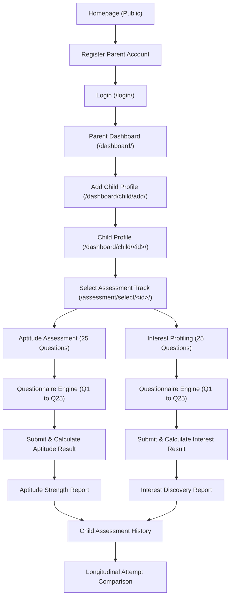
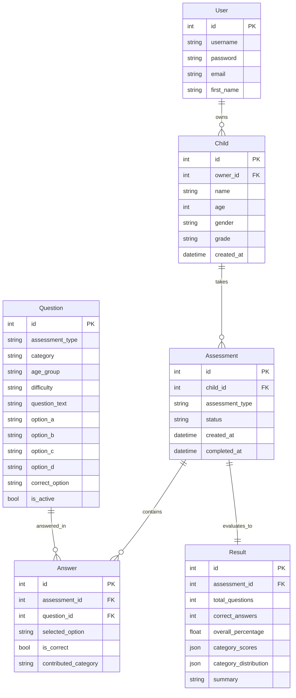

# MindBloom — Detailed Project Architecture & Technical Documentation

**Course:** B.Tech Computer Science & Engineering Semester Project  
**System:** Child Aptitude & Interest Assessment System  
**Framework:** Django 5.2.19 (Python 3.11.9)  
**Database:** SQLite 3  

---

## 1. Functional Modules

MindBloom is architected into three specialized Django applications, following the Model-View-Template (MVT) design paradigm:

### 1.1 Core App (`core`)
- **Parent Authentication:** Registration, login with next-parameter forwarding, session-clearing logout.
- **Parent Dashboard (`/dashboard/`):** Real-time aggregation of children profiles, assessment status counters, and quick actions.
- **Child Profile Management (`/dashboard/child/...`):** CRUD operations for children under the authenticated parent account with safe deletion confirmation.
- **Static Informational Pages:** Homepage, About MindBloom, Academic Contact & Inquiries.

### 1.2 Assessment App (`assessment`)
- **Question Bank Repository:** 150 unique, active multiple-choice questions categorized by assessment track, age group, and difficulty.
- **Developmental Classification (`utils.py`):** Deterministic mapping of ages 5–18 into three developmental stages.
- **Questionnaire Engine:** One-at-a-time question delivery, progress bar calculation, radio-option selection, answer persistence, and submission validation.
- **Session Management:** Prevents URL hopping and ensures question navigation is locked to the active child profile.

### 1.3 Results App (`results`)
- **Evaluation Engine (`services.py`):** Objective percentage and category scoring for Aptitude; preference distribution and domain mapping for Interest.
- **Report Generation:** Generates comprehensive visual strength reports with cognitive highlights, category breakdowns, and constructive feedback.
- **Longitudinal Comparison:** Computes score progression and preference shifts across repeated attempts of the same module.

---

## 2. End-to-End User Workflow



---

## 3. Parent-Child Relationship & Ownership Model

The system enforces a strict relational hierarchy:
- Each `User` (Django `auth.User`) can own multiple `Child` profiles (`Child.owner` foreign key, `on_delete=models.CASCADE`).
- **Authorization Rule:** A child record must belong to the logged-in user:
  ```python
  if child.owner_id is None or child.owner_id != request.user.id:
      raise PermissionDenied("You are not authorized to access this child's profile.")
  ```
- **Unowned Profile Protection:** Legacy or orphaned profiles (`owner_id=None`) are strictly blocked from unauthorized viewer access.
- **Session Decoupling:** `request.session['active_child_id']` stores the child currently active in the UI, but session tokens are never trusted as authorization proof. Database ownership is re-verified on every request.

---

## 4. Assessment Design & Age-Group Classification

MindBloom addresses cognitive maturity variations by dividing ages 5 to 18 into three distinct tiers:

| Tier | Age Range | Label | Pedagogical Focus |
|---|---|---|---|
| `GROUP_1` | 5–8 years | Early Exploration | Visual associations, concrete scenarios, basic counting, simple vocabulary, everyday animal/nature contexts. |
| `GROUP_2` | 9–13 years | Developing Reasoning | Structured problem-solving, multi-step arithmetic, spatial rotation, logical deductions, hobby discovery. |
| `GROUP_3` | 14–18 years | Advanced Exploration | Abstract logical deductions, algebraic reasoning, multidimensional spatial analysis, complex thematic interests. |

### Classification Algorithm (`assessment/utils.py`)
```python
def get_age_group(age):
    if age is None or isinstance(age, bool) or not isinstance(age, int):
        raise ValueError("Age must be a valid integer.")
    if age < 5 or age > 18:
        raise ValueError("Age must be between 5 and 18.")
    if 5 <= age <= 8:
        return 'GROUP_1'
    elif 9 <= age <= 13:
        return 'GROUP_2'
    else:
        return 'GROUP_3'
```
When a parent edits a child's age, the child's developmental group automatically updates for future assessments without modifying or invalidating historical completed assessment records.

---

## 5. Scoring & Result Calculation Mechanics

### 5.1 Aptitude Evaluation (`results/services.py:calculate_aptitude_result`)
- **Questions:** 25 objective multiple-choice questions with 4 options and a single `correct_option`.
- **Difficulty Grading:** Easy (8 questions), Medium (12 questions), Hard (5 questions). Difficulty badges are displayed on the questionnaire interface.
- **Evaluation Formula:**
  $$\text{Overall Percentage} = \left(\frac{\text{Correct Answers}}{\text{Total Questions}}\right) \times 100$$
- **Category Breakdown:** Scores are calculated independently across 5 domains:
  1. Logical Reasoning
  2. Numerical Ability
  3. Spatial Reasoning
  4. Pattern Recognition
  5. Problem Solving
  $$\text{Category Percentage} = \left(\frac{\text{Correct in Category}}{\text{Total in Category}}\right) \times 100$$
- **Relative Strengths:** Categories with scores $\ge 70\%$ are identified as strongest; categories $< 60\%$ are highlighted as growth opportunities.

### 5.2 Interest Profiling (`results/services.py:calculate_interest_result`)
- **Questions:** 25 preference-discovery questions.
- **No Right or Wrong Answers:** `correct_option` is `None`. Difficulty badges are strictly suppressed to eliminate test anxiety.
- **Category Mapping:** Each of the 4 options (`A`, `B`, `C`, `D`) maps to one of five distinct interest domains:
  1. Science and Technology
  2. Arts and Creativity
  3. Social Activities
  4. Nature and Exploration
  5. Sports and Physical Activities
- **Preference Share:**
  $$\text{Domain Percentage} = \left(\frac{\text{Selections for Domain}}{\text{Total Questions Answered}}\right) \times 100$$
- **Primary & Secondary Interests:** Ranked from highest to lowest selection frequency to highlight the child's natural intrinsic passions.

---

## 6. Longitudinal Attempt Comparison

When a child completes two or more assessments of the same module type:
1. **Chronological Ordering:** Assessments are sorted chronologically by completion timestamp (`completed_at`).
2. **Previous vs. Latest Comparison:**
   $$\Delta \text{Score} = \text{Latest Percentage} - \text{Previous Percentage}$$
3. **Category-Level Shifts:** Category score deltas are displayed in a clean comparative table with signed indicators (`+X.X%` or `-X.X%`).
4. **Pedagogical Safeguard:** Clear educational notices clarify that score variations reflect normal developmental progression, question sampling, and practice familiarity rather than permanent intellectual changes.

---

## 7. Database Relationships



---

## 8. Technical Boundaries & Project Limitations

1. **Academic Scope:** MindBloom is created as a B.Tech Computer Science & Engineering software engineering semester project. It uses standard Django MVT, SQLite, and vanilla CSS/JS.
2. **Non-Clinical Design:** MindBloom is not a psychological diagnostic tool, psychiatric evaluation, clinical cognitive assessment, or official IQ test.
3. **Single Active Question View:** Questionnaire responses are recorded via standard POST submissions with previous/next navigation and SQLite state persistence.
4. **Local Deployment:** Configured for development and evaluation using Python 3.11 with SQLite backend; external microservices, asynchronous message queues (Celery), and in-memory caches (Redis) were intentionally omitted in adherence to syllabus constraints.
